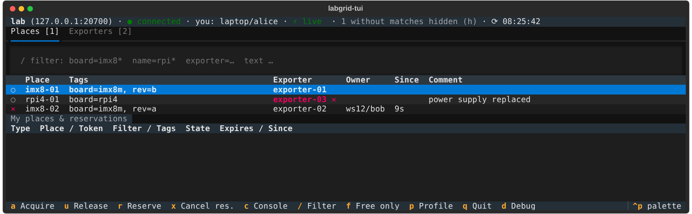
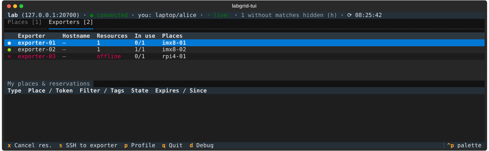

# labgrid-tui

[](https://github.com/C0DE-X/labgrid-tui/actions/workflows/ci.yml)
[](LICENSE)


A terminal UI for [labgrid](https://labgrid.readthedocs.io/). You can see all places with
their tags, filter them, see who holds what, and reserve, acquire and release places
without typing `labgrid-client` commands.





`●` yours · `○` free · `◐` reserved · `✕` held by someone else · `⚠` held longer than `stale_hours`

Exporter column: `rack2 !` some of the place's resources are unavailable · `rack5 ✕` exporter
offline, or the match pattern is misspelled (no resource matches it) · `no matches` the place
has no match patterns, so it isn't linked to any exporter. `Enter` shows which pattern resolved
to what.

## Install

Requires Python ≥ 3.11 and `labgrid-client` on your `PATH` (labgrid ≥ 24, gRPC coordinator).

```bash
pipx install git+https://github.com/C0DE-X/labgrid-tui.git
# if labgrid isn't installed yet:
pipx install "labgrid-tui[labgrid] @ git+https://github.com/C0DE-X/labgrid-tui.git"
```

Or from a clone: `pipx install .` / `pip install .`. Wheels are attached to each
[release](https://github.com/C0DE-X/labgrid-tui/releases).

## Configure

```bash
mkdir -p ~/.config/labgrid-tui
cp config.example.toml ~/.config/labgrid-tui/config.toml
```

Coordinator precedence: `--coordinator` flag > the profile's `coordinator` > `$LG_COORDINATOR` >
`127.0.0.1:20408`. A profile wins over the environment variable, so switching profiles always
works. A profile without `coordinator` uses `$LG_COORDINATOR`. Without a config file the tool
behaves exactly like `labgrid-client` (env var or localhost).

```bash
labgrid-tui                       # default profile
labgrid-tui -P remote             # specific profile
labgrid-tui -x coord.lan:20408    # one-off coordinator
labgrid-tui --list-profiles
```

## Keys

Press **Space** (or `?`) for a menu of every key that works on the current tab, including the
ones not shown in the footer, with the on/off state of toggles. Press a key in the menu to run
it; Esc or Space closes it.

| Key | Action |
|---|---|
| `Space` / `?` | Menu of all keys for the current tab |
| `/` | Focus filter (Enter returns to the table) |
| `1` / `2` | Places tab / Exporters tab |
| `F1`–`F9` | Apply a saved filter from the config |
| `h` | Show/hide places without match patterns (e.g. places that stand for exporters) |
| `f` | Show free places only |
| `o` | Sort by status/name |
| `<` / `>` | Make the Tags column narrower / wider |
| `w` | Long cells: cut off with `…` or wrap onto several lines |
| `t` | Hide/show the Tags column |
| `a` / `u` | Acquire / release selected place |
| `r` | Reserve: prefilled from your tag filter, or `name=<selected place>` |
| `x` | Cancel the selected reservation (bottom pane) |
| `c` | Places tab: open the serial console of an acquired place (the TUI suspends until you exit) |
| `s` | Exporters tab: SSH into the selected exporter's host |
| `Enter` | Details (`labgrid-client show`); on the Exporters tab: show that exporter's places |
| `Tab` | Switch between the places table and "My places & reservations" |
| `p` | Switch profile |
| `d` | Debug console: every `labgrid-client` call |
| `D` | Debug console: hide/show the background refresh calls |
| `y` | Copy the last command (actions first) to the clipboard |
| `Ctrl+R` / `F5` | Refresh now |
| `q` | Quit |

Filter syntax: space-separated terms, all must match. `key=value` (globs allowed:
`board=imx8*`), `key=` (tag exists), `name=pattern` (name or alias), `exporter=pattern`
(exporter name or host), anything else is a substring search over name, aliases, comment,
tags, owner and exporter.

## Columns and long tags

The Tags and Comment columns have a maximum width (40 and 30 characters by default). Longer
content is cut off with `…`; `Enter` shows everything. While running, `<` / `>` change the
Tags width, `w` wraps long cells onto several lines, and `t` hides the Tags column. These
changes last until you quit; set them permanently in the config:

```toml
[ui]
tag_columns = ["board", "location"]   # these tags get their own columns ...
wrap = false
show_tags = true

[ui.column_widths]                    # ... and are left out of the "Other tags" column
tags = 40          # 0 = as wide as the content
comment = 30
name = 0
exporter = 0
"tag:board" = 12   # width of a tag column
```

With many tags, `tag_columns` usually helps most: the 2–3 tags you look at every day get their
own columns, and the rest stays in a narrow "Other tags" column.

## Exporters tab and exporter column

Places don't store their exporter, only match patterns like `rack2/board1/*`. labgrid-tui
resolves them against `labgrid-client -v -v resources` with the same matching rules labgrid
uses.

- **Places tab:** the Exporter column shows the exporter **name** (the first part of the
  resource path). Set `ui.exporter_display` to `host` or `fqdn` to show the hostname there
  instead.
- **Exporters tab (`2`):** one row per exporter with status, **hostname** (the FQDN of the
  machine the exporter runs on), resources (and how many are unavailable), how many of its
  places are in use, and which places it serves. `Enter` jumps to the Places tab filtered to
  that exporter.

labgrid forgets offline exporters: when one disconnects, its resources disappear. An offline
exporter therefore only shows up if a place's match pattern still names it. Its hostname is
then the last one seen while labgrid-tui was running, marked `(last seen)`.

### Places without match patterns

A place without match patterns isn't linked to any hardware, for example places that only
stand for an exporter. These are hidden from the Places tab by default (`ui.hide_unlinked`);
the status bar shows how many, and `h` shows them. This check uses the place's configuration,
not its name, so no naming convention is needed.

## SSH into an exporter

On the Exporters tab, `s` opens an SSH session to the selected exporter's host. The TUI pauses
and comes back when you log out. Keys only work on the tab where they make sense (`c` console on
Places, `s` SSH on Exporters), and the footer shows the current tab's keys.

- **Host:** the FQDN the exporter reports; if unknown (offline and never seen online), the
  exporter name, which defaults to its hostname. Offline exporters can still be reached:
  useful when the exporter service died but the machine is up.
- **User and jump host** per profile; everything else comes from your normal `~/.ssh/config`:

```toml
[profiles.lab]
coordinator = "coordinator.example.com:20408"
ssh_user = "labadmin"     # default: your ssh config / local user
ssh_jump = ""             # "" = use the profile's labgrid `proxy` as -J; "none" = no jump host
# ssh_command = "ssh {jump} {target}"   # template: {target} {host} {user} {name} {fqdn} {jump}
```

If ssh fails, its error stays on screen until you press Enter. The command is also logged in
the debug console.

## Debug console

`d` opens a panel listing every `labgrid-client` call the tool makes, as a command you can
copy and run yourself (including `LG_USERNAME`/`LG_HOSTNAME` if your profile sets them):

```
11:10:05.420 ✓  0.54s LG_USERNAME=alice labgrid-client -x coord:20408 -p KIT1 acquire  → acquired place KIT1
11:10:06.515 ✓  0.56s labgrid-client -x coord:20408 reservations  [refresh]
11:12:41.002 ⚡ 1.02s labgrid-client -x coord:20408 -v places  → Could not connect to coordinator
11:12:41.003 ↻        retry 1/1 in 0.5s
```

`✓` success · `✕` error from labgrid · `⚡` connection error · `↻` retry · `▶` long-running call
started (reservation wait, console). Background refresh calls are dimmed and tagged
`[refresh]`; `D` hides them. `y` copies the last command you triggered. The panel keeps the last
2000 calls.

To keep a record (for example to attach to a bug report), set `ui.log_file`. Every call is
appended there as a tab-separated line: time, result, duration, origin, command, message.

## Reservations

`r` runs `labgrid-client reserve`, then `labgrid-client wait <token>` in the background, which
keeps the reservation alive until it is allocated. With `auto_acquire = true` (the default) the
allocated place is then acquired via `-p +<token> acquire`. A waiting reservation is only kept
alive while labgrid-tui runs: if you quit, it expires on its own after about a minute.

## Connection problems

Every `labgrid-client` call opens its own connection to the coordinator, so a flaky network,
a VPN reconnect or a coordinator restart shows up as individual calls failing. labgrid-tui
handles this as follows:

- **Background refresh:** an outage shows up within seconds as
  `● disconnected 12s – retry in 4s` in the status bar. The last known data stays visible and
  is marked `(stale)`. Reconnect attempts back off (interval, doubling, up to 30 s); `Ctrl+R`
  retries immediately. You get one notification when the connection is lost and one when it's
  back.
- **Read-only calls** (`places`, `reservations`, `show`) are retried with exponential backoff.
- **Acquire, release, cancel and reserve are never repeated blindly.** After a connection error
  the tool first checks whether the first attempt already went through (the connection may have
  dropped after the coordinator handled it). It only repeats the call if it didn't. This way an
  "acquire" that actually worked isn't reported as failed, and you don't get duplicate
  reservations.
- **Waiting reservations** survive short outages: `labgrid-client wait` exits when the
  connection drops, so it's restarted within a few seconds, before the coordinator expires the
  reservation. If the coordinator was restarted and the reservation is gone, it's created again
  with the same filter (`rereserve`). After `wait_give_up` seconds without a connection it
  stops waiting.
- Real errors ("already acquired by …", "matches nothing") are shown right away and never
  retried.

All of this can be tuned in the `[connection]` section of the config.

## Live updates

By default labgrid-tui keeps one `labgrid-client monitor` running and the coordinator reports
changes as they happen. There's no polling while nothing changes, and someone else's
acquire/release shows up within about a second. The status bar shows `⚡ live`.

- Places and resources are refreshed when the monitor reports a change to them, and only that
  part. A burst of events results in one refresh.
- The monitor doesn't report reservations. They're polled every `refresh_seconds`, but only
  while you have an open reservation.
- A full refresh still runs every `fallback_refresh_seconds` (60 s) as a safety net.
- If the monitor stops, the tool switches back to polling every `refresh_seconds` and restarts
  the monitor with backoff. The status bar then shows `polling … (live updates unavailable)`.
  Note: when the coordinator goes away, `labgrid-client monitor` stays silent for a few seconds
  and then exits with code 0, so the tool treats any exit as "live updates lost".

In the debug console, monitor events are tagged `[live]` with a `◆`; `D` hides them together
with the refresh calls. Set `ui.live_updates = false` to always poll.

## How it works

The tool calls `labgrid-client` as a subprocess (`-v places`, `reservations`, `show`, …) and
parses its text output, because labgrid-client has no JSON output. Changes come in through `labgrid-client monitor` (see "Live updates"), with polling as a
fallback. The parser is in `parser.py` and is tested against labgrid 26.0.1 output. If a
labgrid update changes the format, that's the file to fix.

## Development

See [CONTRIBUTING.md](CONTRIBUTING.md) for setup, tests and releases.

## Ideas

- Power on/off/cycle for acquired places
- SSH into the device under test (`labgrid-client ssh`)
- `allow` a colleague on your place, edit tags from the UI

## License

[MIT](LICENSE)
